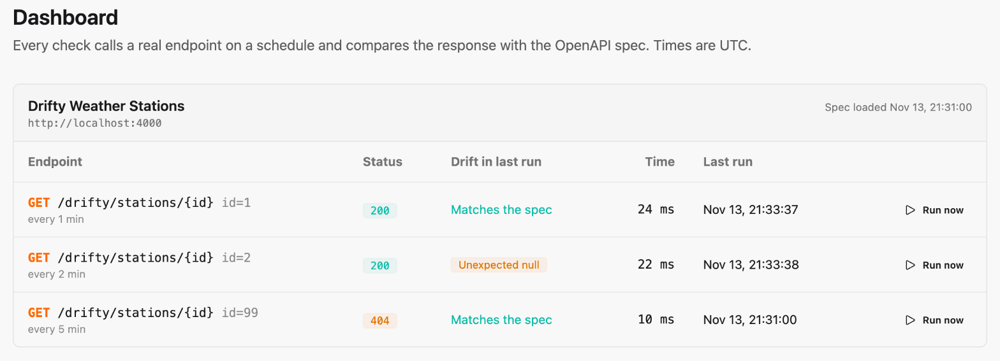
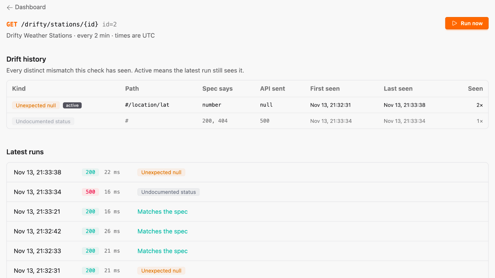

# API Drift Watch

API docs say one thing and the API does another. API Drift Watch calls real endpoints on a schedule and compares every response with the OpenAPI spec. A live dashboard shows where they drift apart: missing fields, wrong types, unexpected nulls, invalid values, undocumented status codes and fields the spec never mentions.

It is built with Elixir, Phoenix LiveView, Oban and PostgreSQL.



## What counts as drift

| Kind | Example |
|---|---|
| Missing field | the spec marks `name` as required and the response has no `name` |
| Wrong type | the spec says `temperature_c` is a number and the API sends `"12.4"` |
| Unexpected null | `location.lat` is `null` while the spec does not allow null |
| Invalid value | `status` is `"maintenance"` but the spec lists only `online` and `offline` |
| Extra field | the response has `humidity_pct` and the spec does not describe it |
| Undocumented status | the API answers `500` and the spec only documents `200` and `404` |

Every drift has a JSON path (like `#/location/lat`), what the spec expected and what the API sent.

## Try it

You need Elixir 1.20 with OTP 29 (see `.tool-versions`) and PostgreSQL with the user `postgres` and password `postgres`.

```bash
mix setup          # dependencies, database, demo data and assets
mix phx.server
```

Open http://localhost:4000. Within a minute the scheduler runs the first checks. Press Run now to run one right away.

The demo watches the drifty API that ships with the app: a small weather station API with its own spec at `/drifty/openapi.json`. About half of its responses break the spec on purpose, so there is always something to see. Ask for a specific drift with `?drift=wrong_type`, for example http://localhost:4000/drifty/stations/1?drift=wrong_type.



## How it works

```
Oban cron, every minute
  └─ SchedulerWorker   queues every check that is due
       └─ CheckWorker  loads the spec, calls the endpoint, stores the run
            ├─ Specs     finds the response schema for the method, path and status
            ├─ Checker   compares the response with the schema
            └─ Monitoring stores the run, updates the drift history, broadcasts on PubSub
                 └─ DashboardLive and CheckLive update live
```

| Module | Job |
|---|---|
| `DriftWatch.Specs` | downloads a spec, finds an operation and the schema for a status code (exact code, then `5XX` style ranges, then `default`) |
| `DriftWatch.Checker` | `compare/4` turns a status and a body into drifts without any IO. `run/3` adds the HTTP call and the timing |
| `DriftWatch.Checker.SchemaErrors` | maps validator errors to drift kinds |
| `DriftWatch.Checker.ExtraFields` | finds fields the schema never mentions |
| `DriftWatch.Monitoring` | the context for APIs, checks, runs and drift history |
| `DriftWatch.Workers.*` | the scheduler and the check runner |
| `DriftWatch.Drifty` | the demo API that breaks its own spec |

## Decisions

**JSV validates the schemas.** OpenAPI 3.1 schemas are JSON Schema 2020-12. I compared four options:

| Library | Why not or why |
|---|---|
| open_api_spex | built to document your own Phoenix API, supports OpenAPI 3.0 only and turns spec strings into atoms when it loads a spec. Its own docs warn against loading untrusted specs that way and this app loads specs from the internet. |
| ex_json_schema | supports JSON Schema drafts 4 to 7 and not 2020-12 |
| Oaskit | OpenAPI 3.1 and built on JSV, but focused on validating requests to your own Phoenix app. Too much framework for this job. |
| **JSV** | full 2020-12 support, passes the official JSON Schema test suite, works on plain maps with string keys and reports every error with its JSON path |

**Our own small layer on top.** A validator answers "is this valid". Drift needs more: which kind of problem and where. `SchemaErrors` keeps the leaf errors (`required`, `type`, `enum` and other value rules) and skips the errors that only say a child failed. For `oneOf` and `anyOf` every branch reports its own errors, which would blame the response for branches it never meant to match. So we drop branches where the value has the wrong type altogether and report the branch with the fewest drifts.

**Extra fields need a separate pass.** JSON Schema allows extra properties by default, so no validator reports them. Adding `unevaluatedProperties: false` to every schema looked tempting, but it breaks `allOf`: a shared component would then reject the properties that the other branch adds. `ExtraFields` walks the response next to the schema instead and counts properties from every composed branch as documented. Objects that allow extra fields on purpose (`additionalProperties`) are left alone.

**A failed call is a result, not a failed job.** Timeouts, connection errors and specs that do not load are stored as runs with an error. Oban does not retry them, because a retry would hide exactly the flaky behaviour this app wants to show. Req retries are off for the same reason.

**Drift history is its own table.** A run is an immutable log entry. A drift is a distinct mismatch of a check (kind, path, expected and actual) with first seen, last seen and a count. Runs link to the drifts they saw. "Since when is this broken" is then one row and not a scan over every run. For type drifts we store the JSON type and not the value, so a changing temperature stays one drift.

**Scheduling decides from the database every minute.** The cron job asks which checks are due and queues them. A restart, a changed interval or a lost job fixes itself on the next tick. Check jobs are unique per check, so a slow API never piles up jobs.

**The demo API lives in the app.** A demo should not depend on a public API that happens to behave that day. The drifty API also makes the best test: for every drift it can produce, a test asserts that the checker finds exactly that drift.

**Tests do not touch the network.** All HTTP goes through `DriftWatch.HTTP`, so tests stub it with `Req.Test`. Some tests route requests into the app's own endpoint and run the whole stack: Oban job, HTTP, spec, checker and database.

**A strict Content Security Policy.** Everything loads from the app itself and nothing runs inline. The theme script that Phoenix puts inline in the layout is a separate file for that reason.

## Quality checks

```bash
mix precommit      # compile with warnings as errors, unused deps, format, Credo, Sobelow, tests
mix dialyzer
mix deps.audit     # known vulnerable dependencies
```

GitHub Actions runs all of them on every push. Formatting uses Styler.

## Limits and next steps

* Only OpenAPI 3.1 and 3.2. Many public APIs still publish 3.0, which uses `nullable` and needs a conversion step.
* JSON specs only, no YAML yet.
* Local `$ref` values only. References to other files are not followed.
* Response headers and content types are not compared yet.
* Next: real public APIs (Open-Meteo, PokeAPI, GitHub and Swagger Petstore) after checking which of their specs are current.
